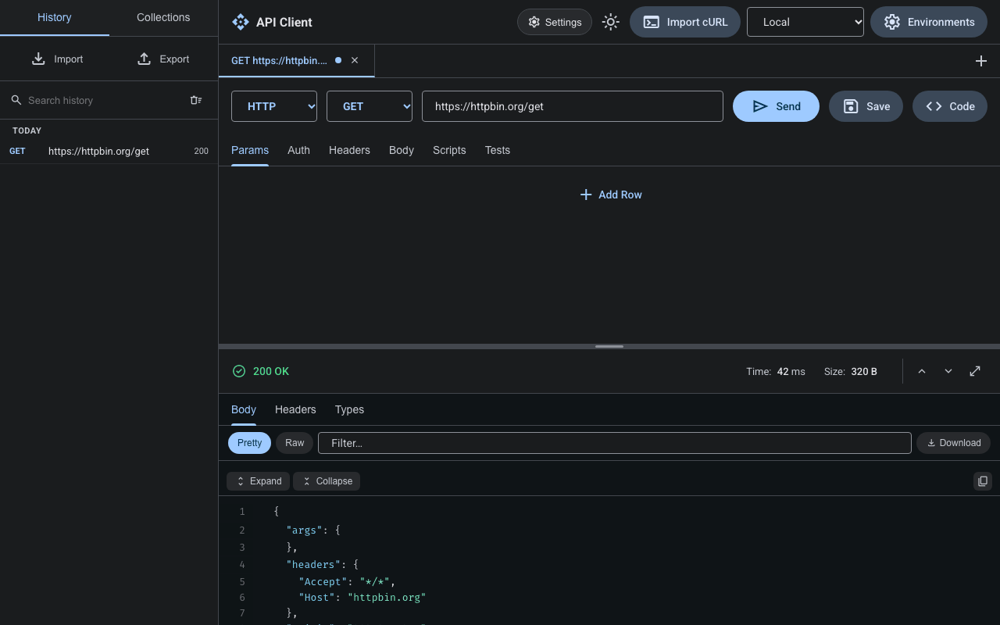

<div align="center">


# VectisAPI

**A free, offline, cross-platform desktop API client: a Postman alternative.**

No account. No cloud. No CORS. Your requests are sent by a native Rust engine and your data stays in
one local SQLite file.

[](https://github.com/shamirul-007/vectisapi/actions/workflows/ci.yml)
[](https://github.com/shamirul-007/vectisapi/releases)
[](LICENSE)

[](https://v2.tauri.app)

[Download](#install) · [Features](#features) · [Build from source](#build-from-source) · [Contributing](#contributing)



</div>

## Table of contents

- [Why VectisAPI](#why-vectisapi)
- [Features](#features)
- [Install](#install)
- [Quick start](#quick-start)
- [Where your data lives](#where-your-data-lives)
- [Importing existing work](#importing-existing-work)
- [Scripts](#scripts)
- [Security and privacy](#security-and-privacy)
- [Build from source](#build-from-source)
- [Project layout](#project-layout)
- [Known limitations](#known-limitations)
- [Contributing](#contributing)
- [License](#license)

## Why VectisAPI

Browser-based API clients run into CORS and cannot reach `localhost` or your LAN without a proxy.
Hosted clients want an account and keep your collections on someone else's server.

VectisAPI is a small desktop app (the macOS `.dmg` is about 6 MB) built on **Tauri 2**: a React UI
on top of a native **Rust** HTTP engine. It makes no network calls of its own; the only traffic is the
requests you send.

## Features

- **HTTP**: any method, params, headers (including `Cookie`, `Host`, `User-Agent`, `Origin`),
  auth (Bearer, Basic, API key, OAuth token, JWT), bodies (raw, JSON, form-data with real files,
  urlencoded, GraphQL). Reaches `localhost`, LAN hosts and self-signed HTTPS (opt-in).
- **Responses**: pretty JSON tree, raw, headers, generated TypeScript types, diff with the previous
  run, timing breakdown, exact-bytes download. Bodies of any size: the first 2 MB render
  immediately, the rest loads on demand ("Load full body").
- **Realtime**: WebSocket (with custom headers and subprotocols) and Server-Sent Events.
- **Scripts**: pre-request and test scripts with a small `pm.*` API, run in a Web Worker with a
  timeout.
- **Collections** with folders, drag and drop, a collection runner with data files, Postman v2.1
  import/export, OpenAPI import, cURL import, code generation.
- **Environments** and globals with `{{var}}` autocomplete; a cookie jar (RFC 6265).
- **History** with search; light and dark themes; keyboard shortcuts and a command palette.
- **Offline storage** in a local SQLite database, saved as you type; full backup export/import.
- **Settings**: request timeout, redirects, TLS verification, HTTP proxy, default User-Agent.

## Install

Download the installer for your OS from the
[Releases](https://github.com/shamirul-007/vectisapi/releases) page:

| OS                            | File                                                 |
| ----------------------------- | ---------------------------------------------------- |
| macOS (Apple silicon + Intel) | `VectisAPI_<version>_universal.dmg`                  |
| Windows                       | `VectisAPI_<version>_x64-setup.exe` (NSIS) or `.msi` |
| Linux                         | `VectisAPI_<version>_amd64.AppImage` or `.deb`       |

The builds are **not code-signed** yet, so the OS will warn the first time:

- **macOS**: right-click the app → **Open** → **Open** (or run
  `xattr -dr com.apple.quarantine /Applications/VectisAPI.app`).
- **Windows**: SmartScreen may warn; choose **More info → Run anyway**.

### Linux note

On some GPU/driver combinations (notably NVIDIA, and some Wayland sessions) WebKitGTK shows a blank
or flickering window. Start the app with the DMA-BUF renderer disabled:

```sh
WEBKIT_DISABLE_DMABUF_RENDERER=1 vectisapi
```

(For the AppImage: `WEBKIT_DISABLE_DMABUF_RENDERER=1 ./VectisAPI_*.AppImage`.)

## Quick start

1. Open VectisAPI. A new request tab is ready.
2. Type a URL (for example `https://httpbin.org/get`) and press **Send** (or `Ctrl/Cmd+Enter`).
3. Read the response in the **Body**, **Headers**, **Types** or **Diff** tabs.
4. Press `Ctrl/Cmd+S` to save the request into a collection.
5. Add an environment (top bar → **Environments**) and use its variables anywhere as `{{name}}`.
6. Press `Ctrl/Cmd+K` for the command palette: environments, cookies, settings, theme, saved requests.

To cancel a request in flight, press **Cancel** or `Esc`.

### Keyboard shortcuts

| Shortcut           | Action                              |
| ------------------ | ----------------------------------- |
| `Ctrl/Cmd+Enter`   | Send the request                    |
| `Esc`              | Cancel the request in flight        |
| `Ctrl/Cmd+K`       | Command palette                     |
| `Ctrl/Cmd+S`       | Save the request                    |
| `Ctrl/Cmd+T`       | New tab                             |
| `Ctrl/Cmd+W`       | Close tab                           |
| `Ctrl/Cmd+I`       | Import a collection file            |
| `Ctrl/Cmd+E`       | Export collections and environments |
| `Ctrl/Cmd+Shift+E` | Manage environments                 |

## Where your data lives

Everything (collections, environments, globals, tabs, history, cookies, settings) is in one SQLite
file, `vectisapi.db`, in the OS app-data folder:

| OS      | Folder                                                                       |
| ------- | ---------------------------------------------------------------------------- |
| macOS   | `~/Library/Application Support/dev.vectisapi.app/`                           |
| Windows | `%APPDATA%\dev.vectisapi.app\`                                               |
| Linux   | `~/.local/share/dev.vectisapi.app/` (or `$XDG_DATA_HOME/dev.vectisapi.app/`) |

**Settings → Open data folder** opens it. **Settings → Export all / Import all** writes and restores
a full backup file. Response bodies are kept in memory only (up to the store cap set in Settings).

## Importing existing work

| From                       | How                                                        |
| -------------------------- | ---------------------------------------------------------- |
| Postman v2.1 collection    | Sidebar → **Import** (`Ctrl/Cmd+I`)                        |
| OpenAPI (JSON or YAML)     | Sidebar → **Import** (`Ctrl/Cmd+I`)                        |
| cURL command               | Top bar or command palette → **Import cURL**               |
| VectisAPI backup (`.json`) | **Settings → Import all** (replaces the current workspace) |
| Workspace folder or zip    | **Settings → Import workspace (zip)** or **(folder)**      |

A workspace folder holds `collections/` and `environments/` with one JSON file per item. Its
collections, environments and globals are merged in by id, so importing twice does not duplicate.

## Scripts

Pre-request scripts run before the request is built; test scripts run after the response arrives.

```js
// Pre-request
pm.environment.set('token', 'abc123');

// Tests
pm.test('status is 200', () => pm.expect(pm.response.code).to.eql(200));
pm.test('has an id', () => pm.expect(typeof pm.response.json().id).to.eql('number'));
```

Available API:

| Object                     | Members                                    |
| -------------------------- | ------------------------------------------ |
| `pm.environment`           | `get(key)`, `set(key, value)`              |
| `pm.variables`             | the current variable map                   |
| `pm.iterationData`         | `get(key)` (collection runner data row)    |
| `pm.response` (tests only) | `code`, `status`, `text()`, `json()`       |
| `pm.test(name, fn)`        | records a pass or a failure                |
| `pm.expect(value).to`      | `eql(expected)`, `be.true()`, `be.false()` |

`eql` compares with `===`, so compare primitives rather than whole objects or arrays. A script that
runs longer than 5 seconds is stopped.

## Security and privacy

- **No telemetry, no account, no update pings.** The app sends only the requests you send.
- **Strict Content Security Policy** in the app window (`script-src 'self'`, no `'unsafe-eval'`,
  no network `connect-src`). Scripts are compiled inside a dedicated Web Worker instead, so the UI
  itself cannot evaluate code. This is covered by an end-to-end test (`e2e/csp.spec.ts`).
- **Scripts are not a network sandbox.** A script runs without DOM access, but treat scripts in
  collections you import like any other code: read them before you run them.
- **Secrets are stored as plain text.** Environment values and cookies are saved unencrypted in
  `vectisapi.db`, and backups include environment values. Protect that file as you would a
  `.env` file.
- **Redirects**: `Authorization`, `Cookie` and `Host` headers you set are dropped when a redirect
  leaves the original origin.

Found a vulnerability? Please report it privately through
[GitHub security advisories](https://github.com/shamirul-007/vectisapi/security/advisories/new)
rather than a public issue.

## Build from source

Requirements: Node 20.19+ (see `.nvmrc`), stable Rust, and the
[Tauri 2 prerequisites](https://v2.tauri.app/start/prerequisites/) for your OS. On Debian/Ubuntu:

```sh
sudo apt-get install -y libwebkit2gtk-4.1-dev libayatana-appindicator3-dev librsvg2-dev
```

Then:

```sh
git clone https://github.com/shamirul-007/vectisapi.git
cd vectisapi
npm ci
npm run tauri dev      # run the desktop app with hot reload
npm run tauri build    # release build + installers in target/release/bundle/
```

### Checks

```sh
cargo fmt --check && cargo clippy --workspace --all-targets -- -D warnings
cargo test --workspace
npm run typecheck && npm run lint && npm run format:check
npm test               # unit tests (Vitest)
npm run test:e2e       # Playwright, Chromium + WebKit, Rust layer mocked
```

Measurement runs (not part of CI): `npx playwright test -c playwright.tools.config.ts`
(UI screenshots → `docs/fidelity/`, 50 MB body timing → `docs/perf.md`).

The icon font is a subset of Material Symbols; after using a new icon run
`python3 scripts/subset-icons.py` (needs `pip install fonttools brotli`). A unit test fails if an
icon is missing from the subset.

## Project layout

| Path                 | What it holds                                                                |
| -------------------- | ---------------------------------------------------------------------------- |
| `crates/vectis-core` | Rust core: HTTP engine, WebSocket/SSE, cookie jar, SQLite storage, search    |
| `src-tauri`          | The Tauri app: IPC commands, window, state                                   |
| `src`                | The React UI (`src/features/vectisapi`) and shared components                |
| `e2e`                | Playwright tests (the Rust layer is mocked)                                  |
| `docs`               | Design spec, UI screenshots, performance numbers, the manual smoke checklist |

## Known limitations

- Builds are unsigned, and there is no auto-update: download new versions from the Releases page.
- WebSocket connections do not use the configured HTTP proxy.
- The `pm.*` script API is small (see [Scripts](#scripts)); most scripts written for Postman need
  adapting, and there is no `pm.sendRequest`.
- Secrets are not encrypted at rest and there is no OS keychain integration.
- No team sync or cloud workspace, by design.

## Contributing

Issues and pull requests are welcome.

1. For anything larger than a small fix, open an issue first so the approach can be agreed.
2. Fork, create a branch, and make your change with tests (Rust tests live beside the code and in
   `crates/vectis-core/tests`; UI tests are `*.test.ts(x)` next to the file they cover).
3. Run everything under [Checks](#checks); CI runs the same commands.
4. Use [Conventional Commits](https://www.conventionalcommits.org/) for commit messages
   (`feat(ui): …`, `fix(http): …`, `docs: …`).
5. Open the pull request and describe what changed and how you tested it.

Changes that touch window close, native dialogs or script evaluation also need the relevant
sections of [`docs/manual-smoke.md`](docs/manual-smoke.md) run on a real build.

## License

[MIT](LICENSE)
